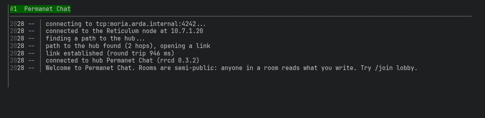

# weechat-rrc

A native WeeChat plugin, written in C, for [Reticulum Relay Chat](https://rrc.kc1awv.net/)
(RRC): IRC-style rooms on hubs reached over the [Reticulum](https://reticulum.network/)
network.



Reticulum support is built in. The plugin implements the parts an RRC client needs
(identities, announce validation, path requests, links with their handshake, encryption,
identify and keepalive, and receiving resources), so it needs no Python and no `rns` package of
its own. It connects to a Reticulum node over TCP, or to the local `rnsd`, and that node routes
it to the hub over whatever the network runs on: TCP, I2P, LoRa.

The examples use [Permanet](https://codeberg.org/permanet), a community Reticulum network
whose chat hub, Permanet Chat, is `rrc://082f8e4293d19281108a5d4faa52dcbe/lobby`.

## From nothing to the Permanet lobby

Permanet links nodes over the internet through I2P only, so nobody on the network learns your
IP address. You run three things on your machine: the I2P router, Reticulum's daemon `rnsd`
(which reaches Permanet through I2P) and WeeChat with this plugin (which talks to `rnsd`).
These steps are for Linux.

### 1. WeeChat and the build tools

Debian and Ubuntu:

```sh
sudo apt install weechat weechat-dev build-essential pkg-config libssl-dev libbz2-dev git
```

Arch:

```sh
sudo pacman -S weechat base-devel openssl bzip2 git
```

Fedora:

```sh
sudo dnf install weechat weechat-devel gcc make pkgconf-pkg-config openssl-devel bzip2-devel git
```

WeeChat 4.1 or later is needed; `weechat --version` tells you which you have.

### 2. The I2P router

```sh
sudo apt install i2pd            # Arch: pacman -S i2pd; Fedora: dnf install i2pd
sudo systemctl enable --now i2pd
```

Reticulum talks to i2pd through its SAM interface on `127.0.0.1:7656`. It is on by default; if
you have changed i2pd's settings, check that `/etc/i2pd/i2pd.conf` has `enabled = true` under
`[sam]`. A new i2pd needs several minutes, sometimes ten or more, to join the I2P network before
anything can be reached through it.

### 3. Reticulum

```sh
pipx install rns                 # or: python3 -m pip install --user rns
rnsd                             # the first run writes ~/.reticulum/config; stop it with Ctrl+C
```

Add Permanet's I2P peers to `~/.reticulum/config`, inside the `[interfaces]` section:

```
  [[Permanet I2P]]
    type = I2PInterface
    enabled = yes
    connectable = no
    peers = gdludub7eejnh3hhdtofakibaxmkivm5zjfl2zdxxd7btt6l4rkq.b32.i2p, 5oi34mlpqikenddpl4r5n2wqwfkk6cctgsoycitfuggrxhfbho6q.b32.i2p, p56eyqodvja5wpzi66unq4czj4iyyqughgaxoj5xvgvp4hhojjwq.b32.i2p
```

Those are the peers Permanet published when this was written. The current list is
[`configs/blueprints/peers/i2p.txt`](https://codeberg.org/Permanet/installer/src/branch/main/configs/blueprints/peers/i2p.txt)
in Permanet's installer. `connectable = no` connects out to them without publishing an I2P
address of your own.

Then keep `rnsd` running. As a systemd user service, `~/.config/systemd/user/rnsd.service`:

```ini
[Unit]
Description=Reticulum daemon

[Service]
ExecStart=%h/.local/bin/rnsd
Restart=on-failure

[Install]
WantedBy=default.target
```

```sh
systemctl --user enable --now rnsd
loginctl enable-linger "$USER"   # keep it running when you are logged out
rnstatus                         # the three I2P peers show Up once i2pd has settled
```

### 4. The plugin

```sh
git clone https://git.pumpin.online/funkpower/weechat-rrc.git
cd weechat-rrc
make
make check          # optional: the unit tests
make install        # into ~/.local/share/weechat/plugins
```

### 5. Join Permanet Chat

Start `weechat`, then:

```
/plugin load rrc
/rrc add permanet rrc://082f8e4293d19281108a5d4faa52dcbe/lobby -nick yournick -autoconnect
/rrc connect permanet
```

The first `/rrc` command creates your Reticulum identity. The `rrc://` link names the hub and
the room to join (`lobby`). With no address given, the plugin uses the local `rnsd`
(`unix:default`).

The server buffer shows each step: a path to the hub found (a couple of hops through
Permanet's I2P peers), the link opened with its round trip, then the hub's welcome. The lobby
opens in its own buffer. Over I2P the first connection can take a minute; if no path is found
in time, the plugin keeps retrying and waits longer after each failure. `-autoconnect`
connects again every time WeeChat starts, and the plugin loads by itself from then on.

Permanet's advice applies here too: pick a nick that isn't your real name or a username you
use elsewhere, and never share the identity file (see [Identity](#identity-and-privacy)).

## Updating

```sh
cd weechat-rrc && git pull && make && make install
```

then `/plugin reload rrc` in WeeChat. Rebuild after upgrading WeeChat too, since the plugin is
built against its plugin API. Install with `make install`, not by copying over the old
`rrc.so`: WeeChat keeps the loaded file mapped, and overwriting it in place crashes the next
reload.

## Where Reticulum is reached

The address is the argument after the hub in `/rrc add`, or `rrc.server.<name>.address`:

| Address | |
| --- | --- |
| `unix:default` | the local `rnsd` (its shared instance), the default; `unix:NAME` for an `rnsd` with `instance_name = NAME` |
| `shared:HOST:PORT` | a shared instance over TCP (`shared_instance_type = tcp`, port 37428 by default), for systems without Linux's abstract sockets |
| `tcp:HOST:PORT` | a `TCPServerInterface` on a Reticulum transport node, such as one you run on another machine |

```
/rrc add permanet rrc://082f8e4293d19281108a5d4faa52dcbe/lobby tcp:node.lan:4242 -nick yournick
```

If the link drops, the plugin reconnects, waiting longer after each failure, and rejoins the
rooms that are open.

## Commands

| Command | |
| --- | --- |
| `/rrc list` | servers and their state |
| `/rrc add <name> <hub\|rrc://hub/room> [<address>] [-nick <nick>] [-autojoin <rooms>] [-autoconnect]` | add a server |
| `/rrc del <name>` | delete a server |
| `/rrc connect <name>\|-all` | connect |
| `/rrc disconnect [<name>]` | disconnect |
| `/rrc join <room>`, `/rrc part [<room>]` | join or leave a room |
| `/rrc nick <nick>` | change your nickname |
| `/rrc ping` | round trip to the hub |
| `/rrc status` | link, hops, round trip, hub limits |
| `/rrc identity` | your identity hash |

## In rooms

`/join`, `/part`, `/me` and `/nick` work as they do on IRC. A room's topic is its buffer
title.

Rooms on `rrcd` hubs, Permanet Chat among them, have operators, modes and topics, run by the
hub's own commands. They work with one slash in RRC buffers, and in a room buffer the room is
filled in, IRC style (`/kick nick` in the lobby kicks from the lobby):

| Command | |
| --- | --- |
| `/topic [text]` | show or set the topic (anyone may, unless the room is `+t`) |
| `/who`, `/names` | who is in the room |
| `/list` | the hub's registered public rooms |
| `/register`, `/unregister` | claim a room (you become its operator and it persists) or give it up |
| `/op`, `/deop`, `/voice`, `/devoice <nick>` | operators and voice |
| `/mode <modes>` | `+m` moderated, `+i` invite only, `+t` only operators set the topic, `+n` no messages from outside, `+p` private, `+k <key>` |
| `/kick <nick>`, `/ban`, `/invite <nick>` | moderation |
| `/kline`, `/stats` | for the hub's operators |

`//cmd` sends any other `/cmd` to the hub. In the server buffer, `//list` and `//who lobby`
work the same way.

Hub notices are shown as `--` lines. A notice someone else sent to the room is shown with their
name, `-nick-`, and is never taken for the hub's own word (a topic change, a member list).

## Colour

Messages can carry [Micron](https://github.com/markqvist/NomadNet) formatting, which NomadNet
draws: colours (`¦F` and `¦B` with three hex digits, `¦FT` and `¦BT` with six, `¦f` and `¦b` back
to the default), bold `¦!` and the rest. The plugin draws them as WeeChat colours, mapped to the
256-colour palette. The tag character is `¦` (U+00A6), as NomadNet's own messages write it,
because NomadNet takes a backtick for Markdown code; the backtick form is drawn too when a
message has a backtick colour code in it. `/set rrc.look.render_micron off` shows the raw tags.

[weechat-ascii](https://git.pumpin.online/funkpower/weechat-ascii) plays IRC and ANSI art into
RRC rooms in this format: `/ascii <name>` in the Permanet lobby's buffer.

## History

Room and server buffers are logged by WeeChat's logger like IRC buffers. When the plugin
creates a buffer again (after `/plugin reload rrc` or a restart), the logger replays its last
lines into it (`logger.look.backlog`, 20 by default). On a reconnect the buffers stay open and
keep everything.

## Settings

Each server's options are `rrc.server.<name>.*`:

| Option | |
| --- | --- |
| `hub` | the hub's destination hash (32 hex characters) |
| `address` | where Reticulum is reached (see above) |
| `nick` | your nickname on this hub |
| `autojoin` | rooms to join on connect, comma-separated |
| `autoconnect` | `on` to connect when WeeChat starts |

| Option | Default | |
| --- | --- | --- |
| `rrc.network.identity_file` | `${weechat_data_dir}/rrc/identity` | the Reticulum identity, created if missing |
| `rrc.network.path_timeout` | `90` | seconds to wait for a path to the hub |
| `rrc.network.debug` | `off` | show paths, link ids and protocol detail in the server buffer |
| `rrc.look.render_micron` | `on` | draw Micron formatting in messages as colours |

## Identity and privacy

Your identity is a Reticulum key pair stored in `identity_file` (mode 0600). Its hash is who you
are to every hub: nicknames are labels anyone can pick. The file uses the same 64-byte format as
`rnid` and other Reticulum programs, so you can use an existing identity by pointing
`identity_file` at it. Keep it private, because anyone with the file can speak as you.

Hubs relay a room's messages to everyone in it. Links are encrypted between you and the hub,
but everyone in the room, and the hub, can read what you write there.

## Finding hubs

Hubs announce themselves on the network. On a machine running `rnsd`, every `rrc.hub` destination
it has heard about is in `~/.reticulum/storage/known_destinations`, with the name the hub
announces:

```sh
python3 tools/list-hubs.py ~/.reticulum/storage/known_destinations
```

Run it with a Python that has the `rns` package. Some entries are stale: a hub can be listed and
no longer answer.

## For scripts

| | |
| --- | --- |
| signal `rrc_input_send` | `"server;room;flags;text"`, like `irc_input_send`. With `raw` in `flags` the text goes as one message exactly as given, and the signal returns `WEECHAT_RC_ERROR` if it doesn't fit or the room isn't joined; without it the text is handled as if typed |
| info `rrc_max_body` | `server,room`: the largest message body in bytes that fits one packet to that room now (`0` when not joined); 350 on `rrcd` |
| info `rrc_queue` | `server`: messages waiting for the hub's rate limit |

Room buffers have the local variables `type` (`channel`), `server`, `channel` (the room) and
`nick`, and their plugin is `rrc`.

## Tests

```sh
make check        # unit tests against vectors from the Python reference implementation
make check-asan   # the same under AddressSanitizer and UBSan
make fuzz         # random and mutated network input through every parser, under ASan
```

`tests/gen_vectors.py` regenerates `tests/vectors.h` with Python RNS. `tests/rrc-cli` is a bare
command-line client for testing against a hub you run yourself (`rrcd`):
`make tests/rrc-cli && tests/rrc-cli 127.0.0.1:4242 <hub-hash> /tmp/id lobby "hello"`, or `-` as
the room to list the hub's rooms.

## Limits

- No direct messages between users yet.
- Resources (what a hub sends when it doesn't fit one packet, such as a long greeting) are
  received up to 256 KiB, in one segment. Larger ones are turned down.
- Your own lines show when they are queued, not when the hub has accepted them.
- Interfaces with IFAC (network name or passphrase) are not supported. Connect through a node that
  handles them.

## License

GPL-3.0. See [LICENSE](LICENSE).
